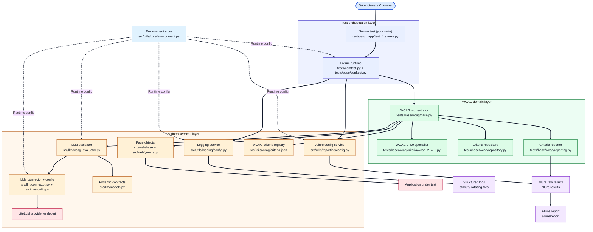
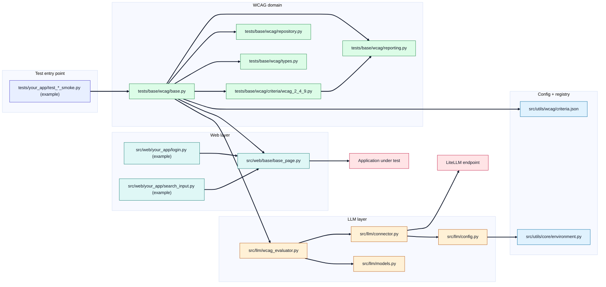
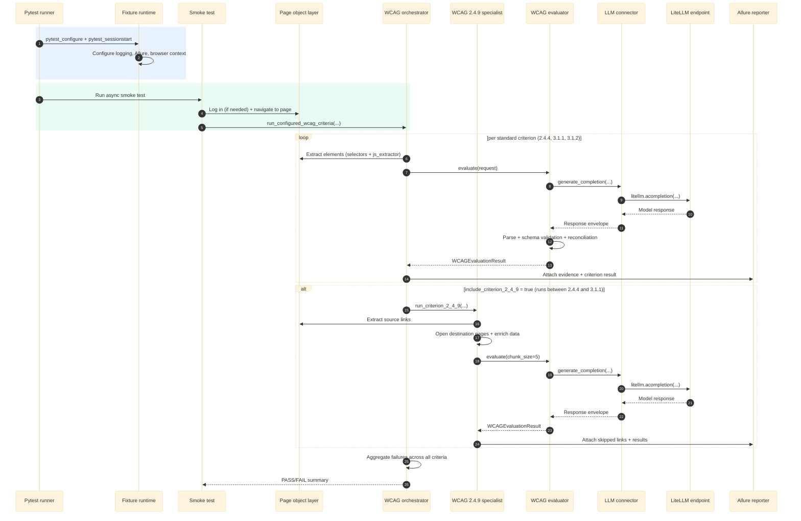
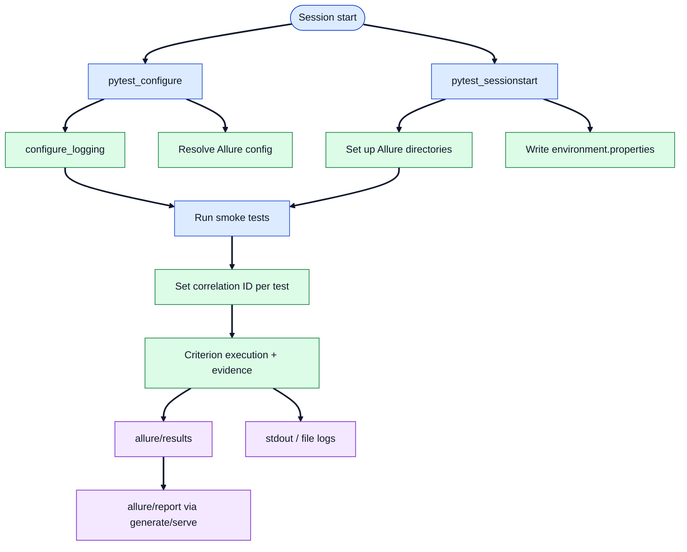

# Developer Guide — a11y-llm

**Audience:** Developers who want to understand, run, or extend the framework.

This guide covers the architecture, code structure, configuration reference,
extension patterns, and quality assurance.

---

## Table of Contents

1. [System overview](#1-system-overview)
2. [Repository structure](#2-repository-structure)
3. [Runtime requirements and dependencies](#3-runtime-requirements-and-dependencies)
4. [Architecture](#4-architecture)
5. [Component reference](#5-component-reference)
6. [WCAG criteria configuration](#6-wcag-criteria-configuration)
7. [Execution model](#7-execution-model)
8. [Error resilience](#8-error-resilience)
9. [Security and privacy](#9-security-and-privacy)
10. [Quality assurance](#10-quality-assurance)
11. [Extending the framework](#11-extending-the-framework)
12. [Known limitations](#12-known-limitations)
13. [Roadmap](#13-roadmap)

---

## 1. System overview

`a11y-llm` is an asynchronous accessibility smoke-testing framework.

**How it works at a glance:**

1. A page object opens a page of the application under test in the
   Playwright browser.
2. CSS/XPath selectors and JavaScript extractors (configured in
   `src/utils/wcag/criteria.json`) pull the DOM evidence relevant to each
   criterion.
3. An LLM (via LiteLLM) evaluates each element against the criterion.
4. The model response is validated against strict Pydantic schemas.
5. Results are attached to Allure as auditable evidence.
6. Any non-accepted status fails the smoke test with an aggregated
   summary.

**Design principles:**

- **Separation of layers** — test orchestration, WCAG domain logic, and
  platform services (web, LLM, logging, reporting) are independent, with
  dependencies pointing inward.
- **Configuration over code** — criteria, prompts, selectors, and runtime
  behavior are data (`criteria.json`, environment variables), not code
  changes.
- **Strict contracts** — every model boundary is a typed Pydantic schema;
  malformed model output is rejected and requested again, never silently
  accepted.
- **Auditable by default** — every test and element result is traceable
  through correlation IDs (logs) and Allure attachments (evidence).

---

## 2. Repository structure

```text
src/
  llm/            LLM configuration, connector, Pydantic schemas, evaluator
  utils/
    core/         EnvironmentStore (typed environment variable access)
    logging/      Structured logging with correlation IDs
    reporting/    Allure configuration lifecycle
    wcag/         criteria.json (selectors + JS extractors + prompts)
  web/
    base/         BasePage (navigation + DOM extraction)
    <your_app>/   Not shipped: your own app-specific page objects
                  (e.g. login.py, search_input.py)
tests/
  conftest.py     Re-exports the base fixtures for all suites
  base/
    conftest.py   Playwright/browser, logging, and Allure fixtures
    wcag/         Orchestrator, reporter, repository, types, unit tests
      criteria/   Criterion-specific runners (2.4.9 enrichment)
  llm/            Evaluator parsing unit tests
  <your_app>/     Not shipped: your own app-specific smoke suites
                  (e.g. test_<page>_smoke.py)
documentation/    This documentation
```

The repository ships only the generic framework. The `<your_app>/`
packages above are examples of what you add yourself for the application
under test.

---

## 3. Runtime requirements and dependencies

- Python `>=3.12,<3.14` (bounded by the range LiteLLM supports)
- [Poetry](https://python-poetry.org/) for dependency management
- Playwright browser binaries (Chromium): `poetry run playwright install chromium`
- Allure CLI (for generating reports locally)

**Runtime dependencies:**
`pytest`, `pytest-xdist`, `pytest-asyncio`, `allure-pytest`, `litellm`,
`pydantic`, `pydantic-settings`, `tenacity`, `concurrent-log-handler`,
`playwright`, `pytest-playwright-axe`, `tqdm`

**Development dependencies:**
`ruff`, `mypy`, `pre-commit`, `pip-audit`

---

## 4. Architecture

### 4.1 End-to-end architecture (layered model)



**Legend:**
- Blue = test orchestration · Green = WCAG domain logic · Orange = platform services
- Pink = external services · Purple = generated artifacts · Light blue = configuration
- Solid arrows = control/data flow · Dashed = runtime configuration injection
- `your_app` = placeholder for the app-specific code you add; it is not part of the repository

---

### 4.2 Core execution components



Nodes marked "(example)" are illustrative files you add for your own
application; they are not shipped with the repository.

---

### 4.3 Runtime sequence



---

### 4.4 Data and contract architecture

```mermaid
%%{init: {'theme':'base','themeVariables':{'lineColor':'#0F172A','fontSize':'15px'},'themeCSS':'.edgePath .path{stroke:#0F172A;stroke-width:2.4px;} .flowchart-link{stroke:#0F172A;stroke-width:2.4px;} .label text{fill:#0F172A;font-weight:500;}'}}%%
flowchart LR
    classDef src fill:#DFF7F6,stroke:#0F766E,color:#111827;
    classDef model fill:#FFF1D6,stroke:#B45309,color:#111827;
    classDef proc fill:#DCFCE7,stroke:#15803D,color:#111827;
    classDef out fill:#F3E8FF,stroke:#7E22CE,color:#111827;

    A["criteria.json\nselectors + js_extractor + prompt"]
    B["DOM extraction\nper locator"]
    C["ExtractedElement"]
    D["WCAGEvaluationRequest\nrule_id + elements"]
    E["Prompt messages\nsystem + user + schema"]
    F["Raw LiteLLM response"]
    G["Normalized JSON payload"]
    H["WCAGEvaluationResult\nstatus + results"]
    I["ElementEvaluationFailure list"]
    J["Allure attachments\nraw response, per element, summary"]

    A --> B --> C --> D --> E --> F --> G --> H --> I --> J

    linkStyle default stroke:#0F172A,stroke-width:2.4px

    class A,B src;
    class C,D,H,I model;
    class E,F,G proc;
    class J out;
```



---

### 4.5 Test, logging, and reporting lifecycle



---

## 5. Component reference

### 5.1 Environment store — `src/utils/core/environment.py`

A single `EnvironmentStore` (subclass of `pydantic_settings.BaseSettings`),
loaded at import time and accessible through `get_environment_store()`. It
provides typed accessor methods: `get_required`, `get_optional`,
`get_bool_*`, `get_int_*`, plus path helpers (`resolve_path`,
`get_runtime_root`).

Unknown variables are ignored (`extra="ignore"`); undeclared variables fall
back to `os.getenv`. Note that this fallback reads only the process
environment: values in `.env` are applied only for variables declared on
`EnvironmentStore`.

---

### 5.2 Logging — `src/utils/logging/config.py`

Process-wide logging, configured idempotently through a
`LoggingConfigurator` singleton.

- **Formats:** `JsonFormatter` (timestamp, level, logger, message,
  correlation ID, module, function, line, service) and `SafeTextFormatter`
  (escapes `\r`/`\n` to prevent log injection).
- **Sinks:** `stdout`, rotating `file` output (via `concurrent-log-handler`),
  or `both`. Handlers are tagged to prevent duplicate registration.
- **Correlation IDs:** via a `contextvars` variable and a custom
  `LogRecord` factory; tests bind the pytest `nodeid` as the correlation ID.

**Public API:** `configure_logging`, `get_logger`, `set_correlation_id`,
`get_correlation_id`, `clear_correlation_id`

---

### 5.3 Reporting — `src/utils/reporting/config.py`

`AllureConfig` (immutable) plus `AllureConfigurator` for preparing the
results and report directories.

**Public API:** `load_allure_config_from_environment`, `configure_allure`
(async), `write_environment_properties` (async). Reports are rendered with
the Allure CLI; the package only prepares directories and environment
metadata.

---

### 5.4 LLM layer — `src/llm/`

- **`config.py`** — `LLMConfig` (frozen dataclass) and `LLMConfigLoader`,
  which reads the `AUDITOR_LLM_*` variables from the environment store.
- **`connector.py`** — `Connector` wraps `litellm.acompletion`. It retries
  with `tenacity` (3 attempts, exponential backoff of 2–10 s). Fixed
  generation settings: `max_tokens=4096`, `timeout=900`,
  `temperature=0.2`, `seed=200994`, `num_ctx=131072`. The
  `CompletionClient` `Protocol` keeps the evaluator transport-agnostic.
- **`models.py`** — strict Pydantic contracts: `ExtractedElement`,
  `WCAGEvaluationRequest`, `ElementEvaluationResult`
  (`PASS`/`FAIL`/`NEEDS_CONTEXT`/`MANUAL_REVIEW`), `WCAGEvaluationResult`
  (`SUCCESS`/`ERROR` + results).
- **`wcag_evaluator.py`** — `WCAGEvaluator` orchestrates the evaluation:
  1. Split elements into chunks (`chunk_size`, default 15).
  2. Build the prompt messages with JSON schema reinforcement.
  3. Call the connector and validate the response (up to 3 validation
     attempts).
  4. Normalize the different output shapes the model may return (object,
     array, single result, fenced/embedded JSON, typed text chunks).
  5. Reconcile coverage: missing element IDs are filled with
     `MANUAL_REVIEW` and the batch status is set to `ERROR`.

---

### 5.5 Web layer — `src/web/`

- **`base/base_page.py`** — `BasePage`: `navigate`, `wait_for_page_load`,
  `extract_elements_by_locator`, `extract_element_data` (runs JS extractors
  on a locator), `run_axe_audit` (placeholder, returns `{}`).

The repository ships no app-specific page objects. You add them for the
application under test as your own subpackage under `src/web/`, for example
`src/web/<your_app>/login.py` (a `LoginPage` for the login flow) and
`src/web/<your_app>/search_input.py` (a page object for the element under
test after login). They inherit from `BasePage` (see
[Section 11](#11-extending-the-framework)).

---

### 5.6 WCAG domain — `tests/base/wcag/`

- **`repository.py`** — resolves and loads `criteria.json` (explicit
  root → `PROJECT_ROOT` → `PROJECT_ROOT_DIR`).
- **`types.py`** — `EmptyBehavior`, `CriterionExecutionConfig`,
  `CriterionFailure`, `CriterionDefinition`, `ElementEvaluationFailure`.
- **`reporting.py`** — `WCAGCriterionAllureReporter` attaches per-element
  evidence; `assert_llm_outcome_or_raise` is the shared PASS/FAIL gate for
  all criterion runners.
- **`base.py`** — the orchestrator: extraction, evaluation, reporting, the
  typed criterion registry (`criterion_steps`), and
  `run_configured_wcag_criteria`, which runs all criteria, collects skips
  and failures, and fails once with an aggregated summary.
- **`criteria/wcag_2_4_9.py`** — the 2.4.9 specialist: resolves link
  destinations, opens each unique destination page once (cached), enriches
  each element with destination metadata, and evaluates with
  `chunk_size=5`.

---

## 6. WCAG criteria configuration

Criteria are declared as data in `src/utils/wcag/criteria.json`.
Each entry contains: `name`, `description`, `url`, `level`,
`selectors` (list), `js_extractor` (a JS function string that returns a
data object per element), and `prompt`.

| Criterion | Name | Level | Empty-extraction policy |
| --- | --- | --- | --- |
| 2.4.4 | Link Purpose (In Context) | A | skip |
| 2.4.9 | Link Purpose (Link Only) | AAA | bespoke (specialist path) |
| 3.1.1 | Language of Page | A | fail |
| 3.1.2 | Language of Parts | AA | pass |

For 2.4.9 the specialist runner handles empty results itself: no candidate
links = pass with an evidence note; all links without a resolvable
destination page = failure.

By default, `run_configured_wcag_criteria` runs 2.4.4, 3.1.1, and 3.1.2.
To run all four criteria, pass `include_criterion_2_4_9=True`.

---

## 7. Execution model

- Tests are asynchronous (`asyncio_mode = "auto"`). The Playwright runtime,
  browser, context, and page fixtures are defined in `tests/base/conftest.py`
  and run on a session-scoped event loop (`loop_scope="session"`); their
  fixture scope is the pytest default (function), so they are created per
  test. `tests/conftest.py` re-exports them for all suites.
- `pytest_configure` initializes logging and resolves the Playwright/Allure
  configuration; `pytest_sessionstart` prepares the Allure directories and
  writes `environment.properties`.
- Each test receives a `test_logger` with a per-test correlation ID and
  a `wcag_criteria` mapping loaded from `criteria.json`.

---

## 8. Error resilience

| Mechanism | Description |
| --- | --- |
| Transport retries | Connector calls are retried 3× with exponential backoff |
| Validation retries | The evaluator re-requests up to 3× when the model response fails JSON parsing or schema validation |
| Coverage reconciliation | Missing element results become `MANUAL_REVIEW` placeholders; the batch status is set to `ERROR` |
| Aggregated failure | `run_configured_wcag_criteria` does not stop at a failed criterion; it collects all skips/failures and fails once with a per-criterion summary |
| Bounded teardown | Browser/context/page teardown is wrapped in `asyncio.wait_for` timeouts |

---

## 9. Security and privacy

- **Secrets** — the LLM API key (`AUDITOR_LLM_API_KEY`) is read only from
  the environment. The framework itself reads no credentials for the
  application under test; if your own suite needs to log in, read optional
  app-specific credentials (for example `APP_USERNAME` / `APP_PASSWORD`)
  from the environment as well. `.env` is git-ignored; only `.env.example`
  (placeholders) is checked in. No secret is written to logs or Allure
  attachments.
- **Data sent to the LLM** — the framework sends extracted DOM evidence
  (and, for 2.4.9, short summaries of the destination page) to the
  configured LLM endpoint. Extractors deliberately collect only
  criterion-relevant fields (data minimization). Do not point the framework
  at pages containing sensitive personal data without reviewing the LLM
  provider's data processing terms.
- **Log hygiene** — the text formatter escapes line breaks to reduce the
  risk of log injection; JSON logs are structured and carry a correlation
  ID.

---

## 10. Quality assurance

```bash
# Lint
poetry run ruff check src tests

# Check formatting
poetry run ruff format --check src tests

# Static type checking
poetry run mypy src tests

# Validate the WCAG configuration
python -m json.tool src/utils/wcag/criteria.json > /dev/null

# Full test suite (requires browser + LLM)
poetry run pytest -vv -rs
```

**Offline unit tests** (no browser, no LLM, no credentials):

```bash
poetry run pytest \
  tests/base/wcag/test_repository.py \
  tests/llm/test_wcag_evaluator_parse.py \
  tests/base/wcag/test_empty_extraction_behavior.py -vv
```

**Git hooks** (recommended):

```bash
poetry run pre-commit install
```

---

## 11. Extending the framework

### 11.1 Adding a new target page

1. Create a subpackage under `src/web/<name>/` and inherit from `BasePage`.
   `BasePage.navigate()` opens `PAGE_URL`, so setting it is usually enough:

   ```python
   # src/web/my_app/home_page.py
   from web.base.base_page import BasePage

   class HomePage(BasePage):
       PAGE_URL = "https://my-app.example.com/"
   ```

2. Create a smoke test under `tests/<name>/test_<name>_smoke.py`:

   ```python
   import pytest
   from tests.base.wcag import create_wcag_evaluator, run_configured_wcag_criteria
   from web.my_app.home_page import HomePage

   pytestmark = pytest.mark.asyncio

   async def test_home_page_a11y(page, context, test_logger, wcag_criteria) -> None:
       home_page = HomePage(page)
       evaluator = create_wcag_evaluator()
       await home_page.navigate()
       await run_configured_wcag_criteria(home_page, evaluator, wcag_criteria, test_logger, context)
   ```

3. If the page requires a login, perform it before calling
   `run_configured_wcag_criteria`, for example with your own `LoginPage`
   page object in `src/web/<name>/login.py`. Read any credentials it needs
   (for example `APP_USERNAME` / `APP_PASSWORD`) from the process
   environment; see [Section 5.1](#51-environment-store--srcutilscoreenvironmentpy)
   for how undeclared variables are resolved. The repository does not ship
   a reference login implementation.

---

### 11.2 Adding a new WCAG criterion

**Step 1:** Add the criterion definition to `src/utils/wcag/criteria.json`:

```json
{
  "1.1.1": {
    "name": "Non-text Content",
    "description": "All non-text content has a text alternative.",
    "url": "https://www.w3.org/WAI/WCAG22/Understanding/non-text-content",
    "level": "A",
    "selectors": ["img", "[role='img']"],
    "js_extractor": "el => ({ id: el.id || el.getAttribute('data-id') || '', alt: el.getAttribute('alt'), src: el.getAttribute('src') })",
    "prompt": "Assess whether the element has an appropriate text alternative ..."
  }
}
```

**Step 2:** For standard handling, add a runner in `tests/base/wcag/base.py`
that delegates to `_execute_standard_criterion` with a
`CriterionExecutionConfig`. For special handling, create a module under
`tests/base/wcag/criteria/`.

**Step 3:** Register the runner in `criterion_steps()` in the desired
order.

**Step 4:** Run the smoke tests and check the Allure evidence.

---

### 11.3 Architectural core of the project

The architectural center of gravity is `tests/base/wcag/base.py`. It
coordinates extraction, evaluation, reporting, and failure aggregation, and
fails once with an aggregated summary instead of stopping at the first
failed criterion.

Key invariants:

- `src/llm/wcag_evaluator.py` enforces schema-driven, chunked evaluation;
  partial model responses cannot silently drop coverage.
- The shared PASS/FAIL gate lives in `assert_llm_outcome_or_raise`
  (`tests/base/wcag/reporting.py`) and is used by both the orchestrator and
  the 2.4.9 specialist.
- `src/web/base/base_page.py` is the only interface to the browser layer;
  all page objects inherit from it.

---

## 12. Known limitations

- `BasePage.run_axe_audit` returns `{}` (placeholder). The Allure attachment
  pipeline is already wired up, so a real axe-core integration can be
  plugged in without changing callers.
- WCAG coverage is limited to four criteria (extensible via configuration).

---

## 13. Roadmap

| Time horizon | Initiative |
| --- | --- |
| Short term | Integrate real axe-core results; extend the prioritized set of WCAG criteria |
| Medium term | Resolve `NEEDS_CONTEXT` via parent/sibling traversal; deterministic baseline suites with a mocked LLM for CI |
| Long term | Multi-page crawling; versioned, reviewable rule packages; formal CI/CD integration with quality gates |
