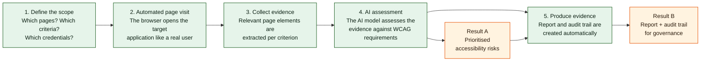

# Management Overview — a11y-llm

**Project:** a11y-llm · **Version:** 0.1.1  
**Audience:** Management, project owners, business stakeholders

This overview gives a compact, honest picture of the project's purpose, value,
scope and maturity. Developers will find technical details in the
[Developer Guide](DEVELOPER_GUIDE.md).

---

## 1. At a glance

`a11y-llm` is an automated testing tool for digital accessibility. It checks
web applications under test for compliance with the WCAG (Web Content
Accessibility Guidelines), which underpin legal and standards-based
accessibility requirements, and produces audit-ready test evidence.

**What it can do:**

- Automatically open pages of the target application and check them for accessibility.
- Assess WCAG criteria qualitatively with the help of an AI model.
- Document test results as structured reports (Allure reports) and logs.
- Make test runs reproducible and traceable.

**What it cannot do yet:**

- Full WCAG coverage of all criteria (four criteria are currently configured).
- Fully automated, continuous operation without manual triggering. A basic CI
  workflow (code checks and unit tests) exists; automated audit runs are still
  to be added.

---

## 2. Why this project?

Digital accessibility is a legal requirement for many web applications, for
example for public-sector websites and applications under the EU Web
Accessibility Directive (implemented in Germany as BITV 2.0). Manual audits are
time-consuming, not reproducible, and expensive to scale.

`a11y-llm` closes this gap: it automates the audit, makes results traceable and
reduces manual effort — without giving up qualitative assessment by AI.

**Expected benefits:**

| Benefit | Description |
| --- | --- |
| Early defect detection | Accessibility issues become visible during development, not only at audit time |
| Shorter test cycles | Automated runs replace time-consuming manual visual checks |
| Audit-ready evidence | Every test result is documented with evidence and a timestamp |
| Better prioritisation | Structured results allow targeted corrective action |

---

## 3. How does it work? (non-technical)

The audit process runs in five steps:

**How to read it:** Green boxes are process steps; orange boxes are the
business-relevant results. Every test run ends with a clear PASSED / FAILED
outcome and a complete body of evidence.

---

## 4. What is checked?

Four WCAG criteria are currently configured:

| Criterion | Name | Level | Meaning |
| --- | --- | --- | --- |
| 2.4.4 | Link Purpose (In Context) | A | Links must make their purpose clear in context |
| 2.4.9 | Link Purpose (Link Only) | AAA | Links must make their purpose clear from the link text alone |
| 3.1.1 | Language of Page | A | The main language of the page must be declared in the code |
| 3.1.2 | Language of Parts | AA | Passages in another language must be marked up separately |

Criterion 2.4.9 (level AAA) is optional and is switched on per test.

The list can be extended. New criteria are defined mainly in a configuration
file; only a small registration step in the code is needed.

---

## 5. Evidence and auditability

Every test run automatically produces:

- **Allure report:** a visual report with test results, per-element evidence
  and, optionally, full-page screenshots.
- **Structured logs:** machine-readable JSON logs with timestamp, correlation
  ID and module context, so every run can be traced.
- **Audit trail:** every element that received an AI assessment is documented
  individually, including its status (PASS / FAIL / NEEDS CONTEXT /
  MANUAL REVIEW).

---

## 6. Risks and mitigations

| Risk | Category | Mitigation |
| --- | --- | --- |
| Low criteria coverage | Functional | Expand the criteria catalogue step by step towards level A/AA |
| No complete CI/CD pipeline yet | Operations | Extend the existing CI workflow with automated audit runs and quality gates |
| Sensitive data sent to the AI model | Compliance | Data minimisation in place; review the LLM endpoint |
| Manual triggering required | Operations | Automated execution via CI/CD planned |

---

## 7. Project maturity

| Dimension | Maturity | Assessment |
| --- | --- | --- |
| Technical | Advanced | Complete architecture, typed interfaces, robust error handling |
| Functional | Initial | Four criteria configured, expansion planned |
| Operations | Preparatory | Basic CI workflow for code checks and unit tests; audit runs triggered manually; processes still to be formalised |

**Conclusion:** The project has a solid technical foundation. The next logical
step is not new development but structured scaling along functional coverage
and operational maturity.

---

## 8. Recommended roles

| Role | Responsibility |
| --- | --- |
| Business / product owner | Prioritise WCAG criteria, define acceptance criteria |
| Technical lead | Architecture decisions, security, integration quality |
| QA / test management | Assess test coverage, regression and evidence quality |
| Operations / DevOps | Set up CI/CD, manage logs and artefacts |

---

## 9. Roadmap

1. **Functional scaling** — Extend coverage to further WCAG criteria at
   levels A and AA.
2. **CI/CD integration** — Extend the existing CI workflow (lint, type checks,
   unit tests) with automated audit runs and report generation.
3. **Operational hardening** — Central secret management, defined retention
   periods for logs and test artefacts, documented LLM endpoint review.
4. **Axe audit integration** — Enable classic rule-based checks as a
   complement to the AI assessment.

---

## 10. Recommendations for production use

- Manage secrets (LLM API keys, target-application credentials) exclusively
  through a central secret store — no plain-text keys in files.
- Define traceable retention periods for logs and test artefacts.
- Before processing potentially sensitive content, review the LLM endpoint for
  data-protection compliance and data residency.
- Set up a reproducible CI/CD pipeline with quality gates for audit runs.
